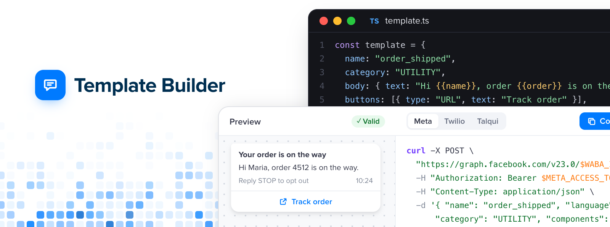

<div align="center"><strong>Template Builder</strong></div>
<div align="center">Preview, validate and create WhatsApp message templates.<br />One JSON object, every provider.</div>
<br />
<div align="center">
<a href="https://template-builder.dev">Website</a>
<span> · </span>
<a href="https://github.com/talqui-oss/template-builder">GitHub</a>
</div>

## Introduction

A small toolkit for WhatsApp message templates, written in TypeScript. Describe a template as plain JSON, check it against Meta's rules before you submit it, render a faithful preview in React or Vue, and get the exact request to create it on Meta, Twilio or Talqui. Prefer the browser? [template-builder.dev](https://template-builder.dev) does all of it with a shareable link, no account needed.

## Why

Templates are the first thing every WhatsApp integration has to get right, and the last thing anyone wants to debug. The rules live in scattered docs, each provider wants a different payload, and you only find out what was wrong after a rejection. Building a template should feel like writing any other piece of typed code: you see it, the editor tells you what breaks, and shipping it is one request away.

## Install

```sh
npm i @talqui-oss/template-builder @talqui-oss/template-builder-react
```

Using Vue? Install `@talqui-oss/template-builder-vue` instead of the React package.

> The first release is on its way. Watch this repository to be notified when it lands on npm.

## Getting started

Describe your template and render it with `<TemplatePreview />`.

```tsx
import type { Template } from "@talqui-oss/template-builder";
import { TemplatePreview } from "@talqui-oss/template-builder-react";

const template = {
  name: "order_shipped",
  language: "en_US",
  category: "UTILITY",
  header: { type: "TEXT", text: "Your order is on the way" },
  body: { text: "Hi {{name}}, order {{order}} is on the way." },
  footer: { text: "Reply STOP to opt out" },
  buttons: [
    { type: "URL", text: "Track order", url: "https://acme.com/t/{{order}}" },
  ],
  variables: { name: { example: "Maria" }, order: { example: "4512" } },
} satisfies Template;

export default function App() {
  return <TemplatePreview template={template} />;
}
```

Then validate it and generate the request for your provider.

```ts
import { validate, toRequest, toCurl } from "@talqui-oss/template-builder";
import { meta } from "@talqui-oss/template-builder/adapters";

const result = validate(template);
if (!result.valid) console.log(result.issues);

console.log(toCurl(toRequest(template, meta)));
```

## Using with AI

Install the Template Builder skill to teach your coding agent (Claude Code, Codex, Cursor, GitHub Copilot, and others) how to build and validate templates:

```sh
npx skills add talqui-oss/template-builder
```

The docs are also available for LLMs at [template-builder.dev/llms.txt](https://template-builder.dev/llms.txt).

## API

A few functions and one component, all typed end to end.

- [TemplatePreview for React](https://github.com/talqui-oss/template-builder/tree/main/packages/template-builder-react)
- [TemplatePreview for Vue](https://github.com/talqui-oss/template-builder/tree/main/packages/template-builder-vue)
- [validate](https://github.com/talqui-oss/template-builder/tree/main/packages/template-builder)
- [toRequest](https://github.com/talqui-oss/template-builder/tree/main/packages/template-builder)
- [toCurl](https://github.com/talqui-oss/template-builder/tree/main/packages/template-builder)
- [defineAdapter](https://github.com/talqui-oss/template-builder/tree/main/packages/template-builder)
- [JSON Schema](https://github.com/talqui-oss/template-builder/tree/main/packages/template-builder)

## Integrations

Templates built with Template Builder can be created on any provider through an adapter. These ship with the package:

- [Meta Cloud API](https://github.com/talqui-oss/template-builder/tree/main/examples)
- [Twilio](https://github.com/talqui-oss/template-builder/tree/main/examples)
- [Talqui](https://github.com/talqui-oss/template-builder/tree/main/examples)

Missing yours? [Request an adapter](https://github.com/talqui-oss/template-builder/issues/new?template=adapter_request.yml) or write one with `defineAdapter`.

## Support

Every template type is checked against the rules Meta applies before review, and every preview is compared with the real app.

| Android    | iOS        | Web        | Desktop    | Meta       | Twilio     | Talqui     |
| ---------- | ---------- | ---------- | ---------- | ---------- | ---------- | ---------- |
| In testing | In testing | In testing | In testing | In testing | In testing | In testing |

## Development workflow

1. [Setting up your development environment](./CONTRIBUTING.md#setup)
2. [Running the commands](./CONTRIBUTING.md#commands)
3. [Opening a pull request](./CONTRIBUTING.md#pull-requests)
4. [Reporting a Meta rule change](./CONTRIBUTING.md#meta-rule-changes)

## Contributing

- [Contribution Guide](./CONTRIBUTING.md)

---

Brought to you by [Talqui](https://talqui.chat), MIT License.
